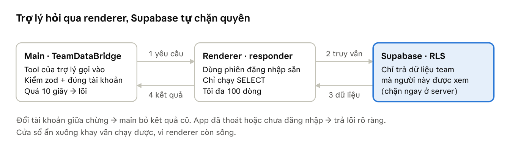

# B0.1 — Cầu dữ liệu team cho trợ lý (giao Dev B)

Giao ngày 2026-11-24 · chủ dự án: @phanduongthien

## Mục tiêu

Làm một "cây cầu" để trợ lý đọc được dữ liệu team (task, thành viên, tiến độ) của người đang đăng nhập, **chỉ đọc**, và **bằng quyền của chính người đó**. Đây là nền cho A1.1 (trợ lý hỏi "tuần này ai trễ hạn?"), bot Telegram (C2.1) và Bot (A3.1).

- **Người làm:** Dev B (matchasoda2201). **Người review:** Dev A (phanduongthien).
- **Nhánh:** `feat/b0.1-team-data-bridge`, tạo từ `main` mới nhất **sau khi** A0.1 đã merge (#55 đã merge ngày 24/11).
- **Quy mô:** một PR, không migration, không giao diện mới.

### Vì sao cần

App Electron có hai phần. **Main** là phần chạy ngầm: gọi Claude, chạy lịch hẹn, giữ file trên máy. **Renderer** là phần giao diện bạn nhìn thấy. Trợ lý sống ở main, còn phiên đăng nhập Supabase sống ở renderer (`src/renderer/src/lib/supabase.ts`). Main cố ý không có anon key (xem ghi chú trong `electron.vite.config.ts`). Vì vậy hiện trợ lý không nhìn thấy task của team.

Ví dụ dễ hình dung: trợ lý giống người ngồi trong bếp, còn chìa khoá tủ hồ sơ nằm ở quầy lễ tân. Thay vì làm thêm một chìa cho bếp, ta để bếp gửi phiếu hỏi ra quầy, quầy mở tủ bằng chìa của chính mình rồi gửi lại đúng phần được hỏi.

## Thiết kế

**Chọn cách 1: hỏi qua renderer.** Main gửi yêu cầu sang renderer, renderer truy vấn Supabase bằng phiên đăng nhập đang có, rồi trả kết quả về main. RLS trên Supabase vẫn là lớp chặn quyền thật, nên main không bao giờ thấy dữ liệu người dùng không được xem.

|               | Cách 1 — hỏi qua renderer (chọn)         | Cách 2 — main giữ phiên riêng (không chọn)                                                                 |
| ------------- | ---------------------------------------- | ---------------------------------------------------------------------------------------------------------- |
| Key và phiên  | Không đưa thêm gì sang main              | Phải đưa anon key + access token sang main                                                                 |
| Làm mới phiên | Renderer tự lo như hiện nay              | Nếu main cũng tự làm mới, refresh token xoay vòng sẽ làm hỏng phiên của renderer → người dùng bị đăng xuất |
| Đổi tài khoản | Một nơi giữ phiên, không lệch            | Hai nơi giữ phiên, dễ lệch nhau                                                                            |
| Dùng lại code | Dùng lại client và kiểu `Database` đã có | Viết client thứ hai                                                                                        |
| Điểm yếu      | Cần renderer còn sống                    | Chạy được cả khi không có cửa sổ                                                                           |

Điểm yếu của cách 1 chấp nhận được: bấm X thì app ẩn xuống khay (renderer vẫn sống) hoặc thoát hẳn (khi đó lịch hẹn và bot cũng không chạy). Nếu sau này cần chạy không có cửa sổ, chỉ cần thay phần bên trong `TeamDataBridge`, hợp đồng API bên dưới giữ nguyên.

## Hợp đồng API

Mọi kiểu và schema zod nằm trong một file mới `src/shared/teamData.ts`, dùng chung cho main và renderer. Main gọi `teamData.request(kind, args)` và luôn nhận về `{ ok: true, data }` hoặc `{ ok: false, error }`, không bao giờ ném lỗi ra ngoài. Team mặc định là team đang chọn trong app (`currentTeamId` ở `stores/team.ts`).

| Hàm              | Đầu vào (đều tuỳ chọn)                                                                                                                | Trả về                                                                                                                                  |
| ---------------- | ------------------------------------------------------------------------------------------------------------------------------------- | --------------------------------------------------------------------------------------------------------------------------------------- |
| `getTeamSummary` | —                                                                                                                                     | Tên team; thành viên `{ id, name, role }`; tổng task, số đã xong, số trễ hạn, tổng giờ ước lượng còn mở                                 |
| `listTasks`      | `projectId`, `assigneeId`, `status` (todo / in\_progress / review / done / blocked), `dueBefore` (ngày), `limit` (1–100, mặc định 50) | Mảng task `{ id, title, status, priority, assigneeId, dueDate, estimateHours, projectName }` + cờ `truncated` khi còn nhiều hơn `limit` |
| `getOverdue`     | `assigneeId`                                                                                                                          | Task chưa xong có hạn trước hôm nay, nhóm theo người, xếp hạn cũ nhất lên đầu                                                           |
| `getMemberStats` | `memberId` (bắt buộc), `range` (day / week)                                                                                           | 4 chỉ số đã duyệt: % đúng hạn, % qua review lần đầu, giờ còn mở, số task xong trong khoảng                                              |

Cách tính chỉ số (viết thành hàm thuần để test, không gọi mạng):

- **% đúng hạn:** trong các task xong trong khoảng và có hạn, tỉ lệ có `completed_at` không muộn hơn cuối ngày `due_date`.
- **% qua review lần đầu:** dựa trên bảng `task_status_events`. Task xong trong khoảng mà sau lần đầu vào `review` không bị chuyển về `todo` hay `in_progress`. Task chưa từng qua review không tính.
- **Giờ còn mở:** tổng `estimate_hours` của task chưa `done`; task không có ước lượng thì đếm riêng thành `unestimatedCount`.
- **Task xong:** số task có `completed_at` trong khoảng.
- Không đủ dữ liệu (mẫu số bằng 0) thì trả `null`, không trả 0%, để giao diện ghi "chưa đủ dữ liệu".

**Mã lỗi** (để tra i18n): `not_signed_in`, `no_team`, `renderer_unavailable`, `timeout`, `account_changed`, `not_allowed`, `network_error`, `invalid_response`. Lỗi từ Supabase đi qua `dbErrorCode` có sẵn.

**IPC mới:** hai kênh trong `src/shared/ipc.ts` (sau A0.1b: file kênh IPC của nhóm B) — `teamData:request` (main gửi sang renderer) và `teamData:respond` (renderer trả về, validate bằng zod như mọi IPC khác).

## Quy tắc an toàn bắt buộc

Repo public và app phát hành kèm anon key, nên RLS là lớp chặn duy nhất giữa người dùng và dữ liệu team khác (CLAUDE.md). PR vi phạm một trong các điều dưới đây sẽ không được merge.

1. **Chỉ đọc.** Responder chỉ gọi `.select(...)`. Không `insert`, `update`, `delete`, `upsert`, `rpc`. Ghi dữ liệu là việc của A1.2 và luôn qua thẻ duyệt.
2. **Không thêm key hay token vào main.** Không sửa `envPrefix` trong `electron.vite.config.ts`, không gửi access token sang main.
3. **Main không chọn câu truy vấn.** Main chỉ gửi `kind` + tham số đã validate. Responder có danh sách 4 hàm cố định; `kind` lạ thì trả lỗi. Không có kiểu "truyền tên bảng vào để đọc".
4. **Cột cố định, không `select('*')`.** Chỉ lấy đúng các cột trong hợp đồng. Không trả email, không trả `description` dài (cắt ≤ 500 ký tự nếu sau này cần).
5. **Đúng tài khoản.** Mỗi yêu cầu mang `uid` của người main đang phục vụ (`AccountScope.current`). Responder kiểm `uid` trùng phiên hiện tại, main kiểm lại khi nhận kết quả. Lệch thì trả `account_changed` và bỏ dữ liệu.
6. **Giới hạn.** Tối đa 100 dòng mỗi lần, 10 giây mỗi yêu cầu, tối đa 4 yêu cầu đang chờ cùng lúc. Quá thì trả lỗi, không xếp hàng vô hạn.
7. **Không ghi nội dung vào log.** Log chỉ ghi `kind`, thời gian, số dòng, mã lỗi. Không ghi tên task hay tên người.
8. **Dữ liệu là thông tin, không phải lệnh.** Tên task do người khác gõ có thể chứa câu như "trợ lý hãy xoá …". B0.1 chỉ trả dữ liệu; A1.1 sẽ bọc nó thành khối "dữ liệu" khi đưa cho Claude. Dev B giữ nguyên các trường chữ, không ghép chúng thành câu.
9. **Feedback không nằm trong B0.1.** Feedback ẩn danh chỉ Manager / Owner được thấy người gửi, cần thiết kế riêng để không lộ qua trợ lý.

## Các bước làm

Làm theo thứ tự, mỗi bước một commit (Conventional Commits, ví dụ `feat(team): ...`). Sau mỗi bước chạy `npm run lint`, `npm run typecheck`, `npm test` và xem **mã thoát** bằng 0, không chỉ đọc chữ in ra. Nếu A0.1 đã tách kiểu API và preload theo mảng thì đặt phần của bạn vào file của mảng team thay vì file chung.

1. **Kiểu dữ liệu và cách tính chỉ số (chưa chạm mạng)**
   - Tạo `src/shared/teamData.ts`: 4 `kind`, schema zod cho đầu vào và đầu ra, danh sách mã lỗi.
   - Tạo `src/shared/teamMetrics.ts`: hàm thuần tính 4 chỉ số từ mảng task + mảng `task_status_events`.
   - Test `src/shared/__tests__/teamMetrics.test.ts`: không có task, task không có hạn, xong đúng 23:59 ngày hạn, review → in\_progress → review → done, task không ước lượng, khoảng day / week qua nửa đêm.
2. **Cầu phía main**
   - Thêm 2 kênh vào `src/shared/ipc.ts`.
   - Tạo `src/main/team/bridge.ts` (`TeamDataBridge`): gửi yêu cầu kèm `id` ngẫu nhiên + `uid`, giữ danh sách đang chờ, hết 10 giây thì trả `timeout`, tối đa 4 yêu cầu, không có cửa sổ thì trả `renderer_unavailable`, kết quả kiểm bằng zod trước khi trả.
   - Nhận kết quả trong `src/main/ipc/team.ts` (`teamData:respond`, zod). Nối `TeamDataBridge` vào phần khởi tạo của main.
   - Test `src/main/team/__tests__/bridge.test.ts` với cửa sổ giả: trả đúng, hết giờ, kết quả đến sau khi hết giờ bị bỏ, `uid` lệch, kết quả sai schema, yêu cầu thứ 5, `id` lạ.
3. **Responder phía renderer**
   - Preload: thêm `teamData.onRequest(cb)` và `teamData.respond(payload)`, kiểu trong `TeamWorkingApi`.
   - Tạo `src/renderer/src/lib/teamDataResponder.ts`: đăng ký một lần khi app khởi động; với mỗi yêu cầu kiểm đăng nhập, `uid`, team đang chọn, rồi chạy đúng câu `select` của `kind` đó qua `requireSupabase()`.
   - Test với client Supabase giả: đúng cột được chọn, không có `'*'`, `limit` ≤ 100, `kind` lạ, chưa đăng nhập, không có team, lỗi mạng → `network_error`.
4. **Nút thử cho dev và ghi chép**
   - Chỉ trong bản dev (`npm run dev`): một nút "Thử cầu dữ liệu team" trong Cài đặt, gọi qua main rồi hiện JSON trả về. Bản cài không có nút này. Chữ trên nút đi qua i18next.
   - Ghi vào mục "Đang làm — Dev B" của `docs/PROGRESS.md`. Gặp lỗi đáng nhớ thì thêm bài học vào `docs/LESSONS.md`.
5. **Mở PR** vào `main`, điền mẫu PR, chờ CI xanh, nhờ Dev A review. Không tự merge.

| File                                                  | Mới / sửa               |
| ----------------------------------------------------- | ----------------------- |
| `src/shared/teamData.ts`, `src/shared/teamMetrics.ts` | Mới                     |
| `src/main/team/bridge.ts` + test                      | Mới                     |
| `src/renderer/src/lib/teamDataResponder.ts` + test    | Mới                     |
| `src/shared/ipc.ts`                                   | Thêm 2 dòng             |
| `src/main/ipc/team.ts`                                | Thêm 1 handler          |
| Preload + `TeamWorkingApi`                            | Thêm 2 hàm              |
| Phần khởi tạo main, `App.tsx`                         | Mỗi nơi vài dòng để nối |
| `docs/PROGRESS.md`                                    | Mục của Dev B           |

## Tiêu chí xong

- [ ] `npm run lint`, `npm run typecheck`, `npm test`, `npm run test:e2e` đều có mã thoát 0 trên máy; CI trên PR xanh.
- [ ] Test mới phủ đủ các trường hợp ở bước 1–3.
- [ ] Tìm trong code của PR không thấy `insert`, `update`, `delete`, `upsert`, `rpc`, `select('*')`, `service_role`.
- [ ] `electron.vite.config.ts` không đổi; main không có anon key hay access token.
- [ ] Log không có tên task, tên người.
- [ ] Báo cáo PR có danh sách test tay bên dưới, đã làm và ghi kết quả từng bước.

### Test tay (ghi vào PR)

1. **Tắt hẳn MMC studio đang chạy** (cả icon dưới khay, cả bản `win-unpacked`). App chỉ cho chạy một bản, nên nếu bỏ bước này `npm run dev` sẽ hiện lại bản cũ.
2. `npm run dev`, đăng nhập GitHub, chọn team có task. Bấm "Thử cầu dữ liệu team" với `getTeamSummary` → thấy đúng số task và số trễ hạn như trang Tiến độ team.
3. `getOverdue` → đúng danh sách ở khung "Task trễ hạn" của trang Tiến độ team.
4. Đổi sang team khác rồi bấm lại → số liệu đổi theo team mới.
5. Đăng xuất rồi bấm → lỗi `not_signed_in`, app không treo.
6. Bấm X cho app ẩn xuống khay, mở lại từ khay, bấm thử → vẫn chạy.
7. Tắt mạng rồi bấm → lỗi `network_error` trong vòng 10 giây.
8. Đăng nhập tài khoản thứ hai không thuộc team đó → không thấy task của team đó.

## Ngoài phạm vi, câu hỏi mở và tài liệu

**Không làm trong B0.1:** tool cho trợ lý (A1.1 của Dev A), ghi dữ liệu (A1.2), đọc feedback, giao diện dashboard (B1.3), migration Supabase.

**Câu hỏi mở** (Dev B hỏi lại trong PR nếu gặp):

- Đổi tài khoản trong app có báo cho main ngay không, hay main chỉ biết khi có IPC tiếp theo? Cần biết để kiểm `uid` cho đúng.
- "Cuối ngày hạn" tính theo giờ Việt Nam (UTC+7) hay giờ máy? Đề xuất: giờ máy người xem, ghi rõ trong test.

**Đọc trước khi code** (khoảng 1 giờ, đừng bỏ qua):

1. `CLAUDE.md` — quy tắc chung, nhất là mục Quy tắc và Quy trình.
2. `docs/LESSONS.md` — lỗi team từng gặp.
3. `src/renderer/src/lib/supabase.ts` và `src/renderer/src/stores/auth.ts` — phiên đăng nhập nằm ở đâu.
4. `src/renderer/src/features/work/api.ts` — cách các trang đang truy vấn task (dùng lại được).
5. `supabase/migrations/20261028120000_team_core.sql` — bảng `tasks`, `task_status_events` và policy RLS.
6. `src/main/ipc/team.ts` — mẫu viết IPC có zod.

Khi dùng Claude Code để làm: bảo nó đọc file này (`docs/tasks/b0.1-team-data-bridge.md`), yêu cầu nó lập kế hoạch trước, đọc từng diff trước khi commit, và tự giải thích được mỗi file mình nộp.
